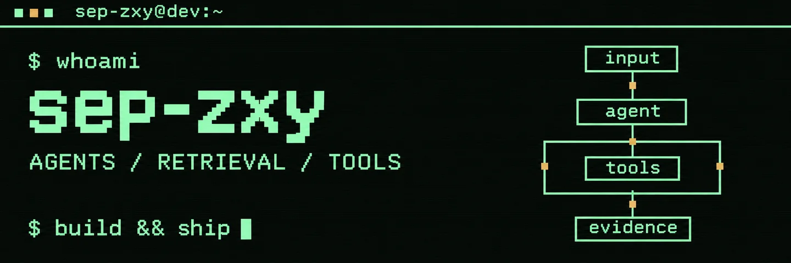
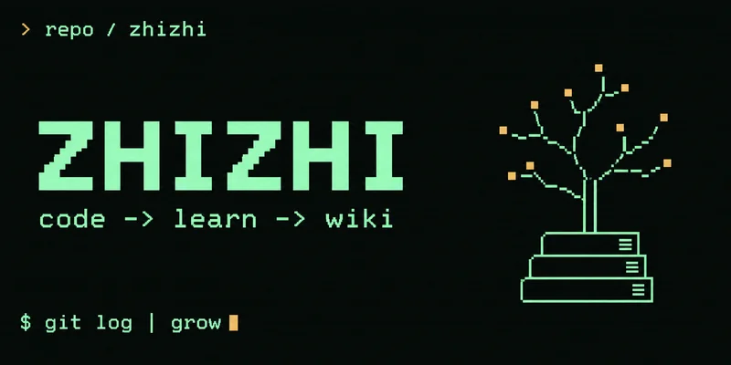
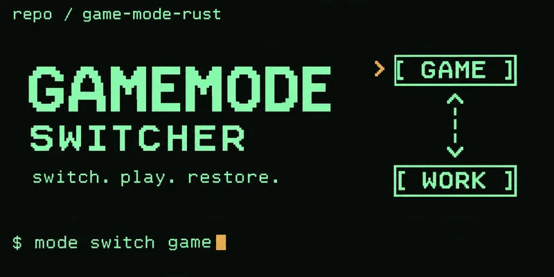

  

  <strong>AI Engineer · Agent Systems · Knowledge Engineering</strong> 
  关注 Agent 的执行语义、上下文组织，以及知识如何被构建、检索和持续更新。

  <a href="#focus">技术方向</a> ·
  <a href="#engineering-notes">工程判断</a> ·
  <a href="#open-source">开源作品</a> ·
  <a href="mailto:1583701031@qq.com">联系我</a>

我是zxy，主要构建 **有状态的 Agent 应用与可追溯的知识系统**。实践覆盖工具协议、上下文与记忆、混合检索和持久化任务执行，也开发 Local-first 应用与自动化工具。

  
  
  
  
  
  
  

### Focus

**Agent Systems & Tooling**

`Tool Calling` · `Tool Contracts` · `Structured Outputs` · `Stateful Sessions`

围绕模型与业务系统之间的执行层，设计工具参数契约、身份与动作校验、结构化结果和多轮任务状态，让一次对话能够继续查询、补充条件并调用真实业务能力。

**Context & Memory**

`Context Engineering` · `Context Assembly` · `Session Memory` · `Summarization`

组织页面上下文、近期对话、摘要、结构化事实和用户状态，处理跨角色记忆、历史恢复与上下文裁剪，保留信息来源和身份边界。

**Retrieval & Knowledge Engineering**

`Hybrid Search` · `RRF` · `Reranking` · `Provenance` · `Knowledge Pipelines`

将原始材料加工为证据、特点关系、Wiki 正文与检索索引，融合向量、文字及关系信号，结合结构化条件完成召回与重排。关注来源引用、冲突信息、版本演进，以及检索结果的解释依据。

**Reliable Execution**

`Idempotency` · `Worker Leases` · `Version Fencing` · `Backpressure` · `Recovery`

围绕任务持久化、租约和执行版本设计取消、重试与恢复；通过幂等、受控写入、负载感知调度和预算预扣，约束重复副作用与过期结果提交。

### Engineering Notes

- **工具契约决定执行边界。** 参数、身份、实体和允许执行的动作由服务端核验；历史结果在执行前重新检查当前条件。
- **取消是执行状态的变化。** Worker 重试或任务被替换后，旧执行需要失去提交资格；租约与版本校验共同约束结果写入。
- **来源属于知识模型。** 正文、证据、特点关系和向量索引各自承担明确职责；结论能回到原始片段，修订保留版本与冲突。
- **模型判断与数据变更分离。** 模型只读查证，结构化决定交由执行器校验；低把握结果补证复判，重要变更保留人工确认、快照与撤回入口。

### Open Source

**知识与学习系统**

- **[知枝 · Zhizhi](https://github.com/sep-zxy/zhizhi)** — 将 Git 提交与代码证据组织为知识候选、理解练习与可编辑 Wiki，连接真实项目实践和 Obsidian。使用 Python、React 与 Electron，采用 Local-first 工作区。
- **[知枝 Next](https://github.com/sep-zxy/zhizhi-next)** — 沿着知枝的实践，继续探索材料收集、原子知识卡、主题 Wiki 和有依据的知识关联，持续开发中。

知枝基于 AhaDiff 继续开发，保留上游署名与许可证。

<strong>Developer Tooling · Rust / Tauri / Automation</strong>

- **[GameMode Switcher](https://github.com/sep-zxy/game-mode-rust)** — 从 Python MVP 迭代到 Rust + Tauri v2，编排应用启停、Clash / TUN / 系统代理切换与状态恢复。
- **[校园网自动登录助手](https://github.com/sep-zxy/Auto-login-on-campus-network)** — 面向巢湖学院，使用 Python / Playwright 完成状态检测和开机静默登录。
- **[Better-CE-Switch](https://github.com/sep-zxy/Better-CE-Switch)** — 用快捷键与超时回切管理中英文输入法。

---

  <samp>Agent Systems / Context / Retrieval / Knowledge</samp> 
  <a href="mailto:1583701031@qq.com">1583701031@qq.com</a>

