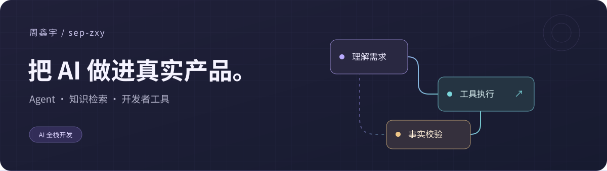
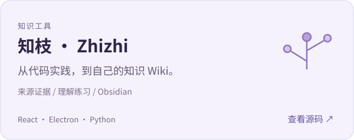
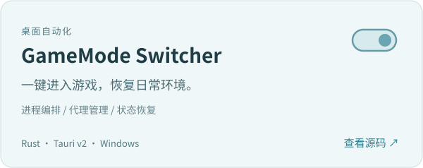

  

  <a href="#-关于我">关于我</a> ·
  <a href="#-开源作品">开源作品</a> ·
  <a href="#-做过的产品">产品实践</a> ·
  <a href="mailto:1583701031@qq.com">联系我</a>

### 👋 关于我

我是周鑫宇，一名 **AI 全栈开发者**。喜欢把重复操作做成工具，也喜欢研究怎样让 Agent 接上真实业务。

- 🧠 做过 **Agent 工具调用、知识检索、会话记忆与任务恢复**。
- 🛠️ 独立设计并落地 **core-data**，也负责过小程序从后端、前端到部署上线的完整交付。
- 🌱 正在做 [知枝](https://github.com/sep-zxy/zhizhi)：把项目实践和阅读，沉淀成自己的知识。
- 💬 欢迎聊 AI 应用、开发者工具和自动化，也欢迎给我的开源项目提建议。

  
  
  
  
  
  
  

### 🧩 开源作品

知枝基于 AhaDiff 继续开发，保留上游署名与许可证。

还有一些解决日常小麻烦的工具：

- [校园网自动登录助手](https://github.com/sep-zxy/Auto-login-on-campus-network) — 面向巢湖学院，自动检测登录状态、开机静默联网。
- [Better-CE-Switch](https://github.com/sep-zxy/Better-CE-Switch) — 用快捷键与超时回切管理中英文输入法。
- [知枝 Next](https://github.com/sep-zxy/zhizhi-next) — 将内容采集、项目实践和个人知识网络连接起来，开发中。

### 🚀 做过的产品

在闲晃担任 **AI 全栈开发（2026.07—2026.11）**，主要做了下面三件事：

| 项目 | 我负责的部分 | 值得展开的点 |
| --- | --- | --- |
| **AI Dock** | Agent 服务、业务工具、会话任务管理，协作前端接入 | 工具调用、事实校验卡片、任务取消与恢复 |
| **core-data** | 独立设计、前后端开发与落地，约一周交付可用首版 | 混合检索、带证据的 Wiki、AI 审核、数据流水线 |
| **万圣节互动活动** | 整体后端、前端还原、活动 Agent、部署运维和埋点 | 约一周开发上线，活动单日新增注册峰值约 **1000 人** |

🔎 展开看看技术细节与数据规模

**AI Dock**：基于 Pi Agent 接入真实业务工具；校验卡片实体、事实来源和允许执行的动作。用任务持久化、Worker 租约、执行版本校验及调用去重，处理取消、重试和旧结果写入。

**core-data**：用 PostgreSQL / PostGIS / pgvector / pg_trgm 融合画像向量、特点关系和文字召回，经 RRF 与模型重排返回结果及证据。模型只读查证，由执行器校验后写入，保留快照和撤回记录；流水线支持暂停续跑、重试、负载调节和预算预扣。

**万圣节活动**：设计六站 NPC 对话，结合商场资料、任务与兑换进度组织上下文，支持跨角色记忆、SSE 流式回复、限流、超时和本地兜底。

数据规模：约 **7.4 万条地点记录**、**45 万余条商品与门店关联**、**9000 余条 AI 来源处理记录**。

规模来自 2026-11-17 简历整理时的数据库副本；AI 来源记录创建于 11 月 5—12 日，包含不同处理状态。注册峰值为活动整体成果。

🏅 竞赛、论文与教育经历

- 巢湖学院 · 计算机科学与技术本科（2022—2026）。
- 第十九届挑战杯：**国家级二等奖、省级金奖**。
- 中国国际大学生创新大赛：**国家级铜奖、省级一等奖**。
- 第九届数维杯大学生数学建模挑战赛：**全国第七名**。
- 第十六届中国大学生计算机设计大赛：**国家级三等奖**。
- 以第一作者发表计算机与医工交叉方向 **SCI 二区期刊论文 1 篇**。

---

  <samp>把有用的想法，做成能用的东西。</samp> 
  <a href="mailto:1583701031@qq.com">1583701031@qq.com</a>

